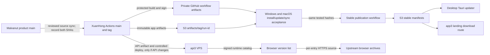

# BugLogin 3.0 Release and Deployment Runbook — Windows Workstation

This runbook documents the Windows release workstation at `F:\Herd\buglogin` and its local build target at `G:\buglogin-target`. The same source commit is built on protected GitHub Actions runners for Windows x64 and macOS arm64. A local Windows build is for development and smoke testing; it is not an official release artifact.

Follow the shared [desktop release contract](desktop-release-contract.md) for build, updater, signing, S3 publication, and installed-app smoke gates. The Actions repository must carry an identical copy before running release workflows.

## Release authority and channels

- Main product/source repository: `keyduc91/Malvanut-Login`, default branch `main`. This is the source of truth for approved BugLogin desktop, API, and web source changes.
- Release automation/API source repository: `XuanHongitHub/buglogin-3.0`, default branch `main`. This repository holds the configured protected signing/publishing environment and its own release/API workflows. A workflow checks out code and tags from this repository; it does not automatically build code from Malvanut Login. Do not assume this repo has the newest Malvanut product source.
- Release execution rule: first push reviewed product source to `keyduc91/Malvanut-Login/main`, then synchronize and review the release source on `XuanHongitHub/buglogin-3.0/main`. Record both commit SHAs and verify the release-critical files and workflow inputs agree. Create the workflow's release tag in the Actions repository only after that sync is verified. A same-named tag in both repositories is useful for traceability, but the two tags may point to different commit SHAs; record both.
- This workstation's configured aliases are `malvanut-login-1.0` → `keyduc91/Malvanut-Login` and `origin` → `XuanHongitHub/buglogin-3.0`. Always verify with `git remote -v` before push/tag. Never force-push or assume a tag in one repository exists in the other.
- Release version authority: root `Cargo.toml` workspace version, `apps/desktop/package.json`, `apps/desktop/src-tauri/tauri.conf.json`, `Cargo.lock`, release tag, and generated feed/assets must agree.
- Supported desktop release targets in the current release workflow: Windows x64 and macOS arm64. Do not advertise Intel macOS until a matching browser runtime is supported and verified.
- Release signing runs in protected GitHub Actions environments. Windows Authenticode is optional; the Tauri updater signature is required when updater support is enabled. macOS requires Developer ID signing, notarization, stapling, and Gatekeeper checks.
- The canonical updater channel manifests are on DigitalOcean Spaces, not GitHub Pages. Candidate release assets are also attached to GitHub Releases; immutable app artifacts are copied to Spaces. The stable feed is `https://mavelnut-login.sgp1.digitaloceanspaces.com/releases/desktop/v3/stable/latest.json`.

### Tauri asset-path safety (required)

`G:\\buglogin-target` is a local build/cache location only. Never inject its absolute Windows path into `build.frontendDist`: Tauri may parse the drive prefix (`G:`) as a URI and ship an app that opens the build folder instead of its embedded UI. The build wrapper must stage the Vite output under a temporary repository-relative directory, pass that relative directory to Tauri, and remove the stage after bundling. `release:verify` must test this rule before signing. After installing an updater artifact, launch the installed executable and confirm the BugLogin UI loads with the original build directory unavailable; a version label or successful signature alone is insufficient.

Manual update checking is check-only. The app must show the detected version and let the user choose **Update now** or **Later**. Download/install and app shutdown happen only after that explicit choice, followed by a separate restart action. Startup auto-update behavior is controlled independently by the user's auto-update setting.

## End-to-end release order

Use this order so the desktop cannot get ahead of its API, browser catalog, updater feed, or landing page:

1. Review and version the product source in `keyduc91/Malvanut-Login/main`; run the required checks and push the reviewed commit.
2. Synchronize the release source into `XuanHongitHub/buglogin-3.0/main`. Compare the release-critical files listed below and record the product SHA and Actions-repository SHA. Do not dispatch a workflow while the version or relevant source differs.
3. If the API contract or signed runtime catalog changed, deploy the matching API first using [staging-topology.md](staging-topology.md) and the API artifact workflow. Verify the public API before building the desktop that depends on it. Do not deploy the API for a desktop-only change.
4. If the landing/download handler changed, keep it aligned with the manifest schema produced by the release workflow. Publish the landing only after the stable manifest and both platform downloads are publicly readable.
5. Tag and run the signed desktop candidate from `XuanHongitHub/buglogin-3.0`. Verify GitHub release assets, S3 immutable artifacts, signatures, hashes, SBOM, provenance, and feed readback.
6. Install and test those exact candidate bytes on Windows and macOS. Record the evidence; build success or notarization alone is not device acceptance.
7. After OS acceptance and release approval, publish the tested hashes to the stable S3 feed with `Publish BugLogin Stable Update Feed`. This updates stable S3 metadata; it does not rebuild the app or deploy the API/web service. There is no public RC feed in this release flow.
8. Verify the app updater and landing download flow from a clean client. Deploy the website separately when its source changed. A `buglogin.com`/`www` DNS or Cloudflare cutover is a separate operation, never an implicit part of desktop release.

Release-critical source to compare between the two GitHub repositories includes the version files and `Cargo.lock`, desktop Tauri updater configuration, signed runtime-catalog fallback/trust keys, release assembly/verification scripts, `.github/workflows/release.yml`, `signing.yml` and `promote-stable.yml`, API runtime-catalog code/config contract, and web `/api/downloads/latest` handler. Preserve repository-specific secrets, environment approvals, and deployment settings in GitHub; do not copy them into source.



## Where app installers and browser versions live

These are separate distribution paths:

| Item | Version/configuration authority | Download/storage location |
|---|---|---|
| BugLogin app installer and Tauri updater packages | Signed source SHA in the Actions repository, synchronized from the product repository | Private candidate files are retained in the successful GitHub workflow run, then copied to Spaces under `releases/desktop/v3/artifacts/v<version>/<run-id>/` during stable publication. The app checks the S3 `stable/latest.json` feed. |
| Browser runtime version list | Live signed `GET https://api3.buglogin.com/v1/runtime/catalog`; if that request fails, the desktop source falls back to `apps/desktop/src-tauri/runtime-catalog.json` | Catalog metadata comes from the API or embedded fallback. It contains each runtime archive's own HTTPS `source` URL; it is not the Tauri updater feed. The API serves the catalog configured by `XuanHongitHub/buglogin-3.0`'s API deployment. |
| Browser runtime archive bytes | The `source` field of each signed catalog entry | Current embedded entries point to `github.com/XuanHongitHub/wayfern-windows` for Wayfern 154 Windows x64, and `download.wayfern.com` for Wayfern 154 macOS arm64 and Wayfern 155 Windows x64/macOS arm64. These browser archives are not currently stored in the BugLogin v3 app-artifact Spaces prefix. |
| Installed browser runtime on this Windows device | Verified catalog release receipt | `%LOCALAPPDATA%\BugLogin\runtimes\wayfern\windows\x64\versions\<version-hash>\`. Each installed version has `.buglogin-install.json` with its version and source. This is local device storage, not S3 or GitHub. |

Keep application artifacts (`releases/desktop/v3/...`) separate from private profile-sync objects (`buglogin3/prod/...`). Do not test public download permissions by changing sync-object ACLs or writing probe files into the production sync prefix.

The embedded fallback currently lists these Wayfern archives:

| Version | Platform | Archive source in embedded catalog |
|---|---|---|
| `154.0.8037.57` | Windows x64 | [GitHub release asset](https://github.com/XuanHongitHub/wayfern-windows/releases/download/v154.0.8037.57/wayfern-154.0.8037.57_windows_x64.zip) |
| `154.0.8037.57` | macOS arm64 | [Wayfern CDN](https://download.wayfern.com/wayfern_154.0.8037.57-1.1_macos.dmg) |
| `155.0.8059.79` | Windows x64 | [Wayfern CDN](https://download.wayfern.com/wayfern-155.0.8059.79_windows_x64.zip) |
| `155.0.8059.79` | macOS arm64 | [Wayfern CDN](https://download.wayfern.com/wayfern_155.0.8059.79-1.1_macos.dmg) |

The live API catalog can differ, so inspect both before a release. These are upstream browser downloads; they are distinct from BugLogin app installers and are not in the BugLogin app-artifact S3 prefix.

PowerShell checklist from `F:\Herd\buglogin`:

```powershell
# Versions and upstream archive URLs embedded in this desktop build
$embedded = Get-Content 'apps/desktop/src-tauri/runtime-catalog.json' -Raw | ConvertFrom-Json
$embedded.releases | Select-Object runtime, version, platform, architecture, source, sha256, sizeBytes | Format-Table -AutoSize

# Versions and URLs currently served by the production API. The endpoint requires a correlation ID.
try {
    $live = Invoke-RestMethod 'https://api3.buglogin.com/v1/runtime/catalog' `
        -Headers @{ 'x-correlation-id' = [guid]::NewGuid().ToString() } -TimeoutSec 20
    $live.releases | Select-Object runtime, version, platform, architecture, source, sha256, sizeBytes | Format-Table -AutoSize
} catch {
    Write-Warning 'Production runtime catalog could not be fetched; the app may be using its signed embedded fallback.'
}

# Installed Wayfern versions and the source each was installed from on this Windows user account
$runtimeRoot = Join-Path $env:LOCALAPPDATA 'BugLogin/runtimes/wayfern/windows/x64/versions'
Get-ChildItem -LiteralPath $runtimeRoot -Filter '.buglogin-install.json' -Recurse -File -ErrorAction SilentlyContinue |
    ForEach-Object {
        $record = Get-Content -LiteralPath $_.FullName -Raw | ConvertFrom-Json
        [pscustomobject]@{ Version = $record.release.version; Source = $record.release.source; Receipt = $_.FullName }
    } | Format-Table -AutoSize
```

For production, the API reads its signed catalog and public trust keys from `BUGLOGIN_RUNTIME_CATALOG_PATH` and `BUGLOGIN_RUNTIME_TRUST_KEYS_PATH` (or the documented inline JSON pair) in the API deployment configuration. The runtime catalog is not uploaded by the desktop updater workflow. Catalog entries must be signed by the approved runtime signer and their package size, SHA-256, platform, architecture, executable path, and source URL must match the actual archive. See [runtime catalog publication](runtime-catalog-publication.md). Never put the runtime signing private key in either repository or API configuration.

## API and VPS deployment

The packaged desktop uses `https://api3.buglogin.com`; the 3.0 API runs on the isolated BugLogin VPS as `buglogin3-api.service` behind the `buglogin3-prod` tunnel. `api.buglogin.com` is still the legacy 1.0 hostname. Do not change it as part of a 3.0 release.

- Deploy the API only when API source, database contract, or runtime-catalog serving configuration changed. Use the `BugLogin Native Linux API Artifact` workflow in `XuanHongitHub/buglogin-3.0`, then follow [staging-topology.md](staging-topology.md) to verify artifact attestations, package the Linux artifact, run the systemd helper's dry run, and deploy the exact pushed commit. That helper changes only the isolated API binaries/unit; it does not edit env files, database, DNS, or Cloudflare.
- Before and after deployment, verify `/v1/readyz`, require `X-BugLogin-Runtime-Catalog: available`, compare served OpenAPI bytes/operation IDs with the source, and test the advertised login/profile/sync operations. If the desktop release depends on a new API operation, do not release the desktop until that operation is present and permission-checked on the live API.
- For a browser-version/catalog change, update the signed catalog and matching public trust-key configuration through the API's documented configuration path; deploy the API if its files/config must change. Then read `GET /v1/runtime/catalog` with `x-correlation-id`, verify the expected platform/version/source/checksum entries, and download/hash-check the actual packages. Do not update a runtime version just by changing a UI dropdown or the embedded fallback.
- Keep VPS service/env/host details and credentials in the approved operations inventory. Never put an SSH key, `.env`, S3 secret, runtime signing key, or tunnel token in the release repo or this runbook.

## Landing page and public download route

The web app runs separately at `https://app3.buglogin.com` as `/opt/buglogin3-web/current` behind the existing tunnel. The landing page's `/api/downloads/latest` handler fetches the stable S3 download manifest with `no-store`, validates the artifact host/prefix, returns the stable version/platform buttons, and redirects a platform request to the installer. It intentionally does not offer the RC feed as a public stable download.

Before deploying web code, match the route's schema to the release workflow. The current Actions repository workflow publishes both `stable/latest.json` (Tauri updater metadata) and `stable/downloads.json` (manual installer metadata). Its current download route consumes `downloads.json`; the Malvanut source route consumes the `downloads` field in `latest.json`. Do not mix a route from one snapshot with a workflow/promotion job from the other. Verify which pair is being deployed and require both files/fields and artifact URLs to agree on version and hashes.

For web changes, use [web-production-deploy.md](web-production-deploy.md): package from a clean pushed commit to `G:\buglogin-target\web-artifacts\<commit>`, run the deployment helper with `-DryRun`, then deploy only the reviewed immutable bundle. Verify `https://app3.buglogin.com/api/downloads/latest` returns the intended stable version and platform URLs; verify `?platform=windows` and `?platform=macos` redirect to public installer URLs with HTTP 200. A 503 means the stable manifest/feed is unavailable. Route `buglogin.com` and `www.buglogin.com` to the 3.0 tunnel only as a separate reviewed domain cutover after the app3 checks pass; preserve the legacy API route until explicitly migrated.

## Workstation setup

1. Open PowerShell in `F:\Herd\buglogin`. Check `git remote -v` and confirm both aliases map to the repositories named above.
2. Use the pinned tools from [toolchain-pins-v1.md](toolchain-pins-v1.md): Node.js 24.18.0, pnpm 11.10.0, Rust 1.95.0, Windows runner `windows-2025`, and macOS arm64 runner `macos-14`.
3. Keep local Rust/Tauri output off the source drive:

   ```powershell
   $env:CARGO_TARGET_DIR = 'G:\buglogin-target'
   pnpm install --frozen-lockfile
   ```

4. Do not put API credentials, signing keys, certificates, notarization passwords, updater private keys, or S3 credentials in the checkout, terminal transcript, release notes, or evidence bundle. Protected credentials belong in the named GitHub Actions secrets/variables only.

The root `.gitignore` excludes local `binaries.build-restore-*` recovery directories created by the desktop build helper. The configured Cargo target is outside this checkout, so it does not need a repository ignore entry.

## Before tagging

1. Confirm the reviewed product source is pushed to Malvanut `main`, then that the corresponding release source is synchronized to Actions `main`. The Actions workflow builds its own tagged checkout, so checking only the product repository is insufficient.

   ```powershell
   git status --short
   git fetch malvanut-login-1.0 main
   git fetch origin main
   git status --porcelain --untracked-files=all
   ```

   Check the product and Actions remote commit SHAs separately. Stop if either checkout is dirty, the versions differ, or the release-critical files have not been reconciled.

2. Update the release version consistently in the workspace/package/Tauri metadata and regenerate the lockfile through the repository's pinned Cargo/pnpm tools. Review the complete lockfile diff; do not hand-edit unrelated dependency resolutions.
3. Run the repository's required local checks and verify version/lock consistency. Confirm package version and Tauri version are exactly the intended release version.
4. In `XuanHongitHub/buglogin-3.0`, confirm workflows are enabled and the protected `release-signing`, `release-publish`, and `stable-promotion` environments have the required approvals and credentials configured. Verify secret/variable names and presence in GitHub settings; never print values.
5. Confirm GitHub Actions billing and runner availability for both `windows-2025` and `macos-14`. A workflow that is queued without a runner or fails before job steps is not release evidence.
6. Confirm the S3 account can upload public immutable artifacts and the stable updater feed. Verify public reads from a clean client; do not use sync-storage credentials or paths.
7. Run the browser-version checklist above. Confirm the production API catalog is available and signature-valid, identify every supported runtime version and its direct archive host, then confirm the app's embedded fallback contains compatible entries. Confirm each archive URL returns the expected bytes and matches the signed size/checksum before advertising that version.
8. In each repository checkout, verify the release tag does not already exist and the tagged commit is an ancestor of that repository's `main` (`git merge-base --is-ancestor <tag> origin/main`). The release workflow itself validates the requested version and tag checkout but does not prove the tag is reachable from `main`; the operator must enforce this policy.

## Build signed candidate artifacts

Run `BugLogin Release Verification` from `main` in `XuanHongitHub/buglogin-3.0`, after synchronizing the reviewed release source there. It builds and signs Windows/macOS artifacts and retains them as private workflow artifacts. It does not publish an RC or change the stable feed. The source SHA must be on the Actions repository's default branch.

After the versioned source is reviewed and synchronized, verify both repositories point to the intended source content and record both SHAs. The release workflow is dispatched from the Actions repository's default branch with the product version/tag as release reference; do not create or overwrite a tag that already exists. Preserve both source/tag-to-SHA mappings. From the Actions-repository checkout, dispatch:

```powershell
$version = '<approved-version>'
$tag = "v$version"
git tag -a $tag -m "BugLogin $tag"
git push origin $tag
gh workflow run 'BugLogin Release Verification' --repo XuanHongitHub/buglogin-3.0 --ref main -f "release_ref=$tag"
gh run list --repo XuanHongitHub/buglogin-3.0 --workflow release.yml --limit 5
```

Do not replace published bytes for an existing version. A correction requires a new patch version and a new signed candidate run.

The protected signing job must produce and verify:

- Windows NSIS installer plus matching Tauri `.exe.sig` updater signature.
- macOS arm64 signed app and DMG, accepted by Apple notarization, stapled, and validated by Gatekeeper; plus the signed `.app.tar.gz` and `.sig` updater pair.
- SHA-256 checksums, SPDX SBOM, GitHub build provenance attestations, and version/platform evidence.
- `latest.json` for signed Tauri updater URLs/signatures and `downloads.json` for manual installer URLs (if using the current Actions workflow), both matching the version and immutable S3 artifact prefix.
- Private GitHub workflow artifacts and S3 immutable artifacts whose downloaded bytes have the recorded checksums. The canonical public stable updater/download manifests are the S3 objects.

Review the workflow summary and logs for Windows and macOS jobs. Confirm the macOS notarization result says Accepted and staple validation succeeds. Never treat a macOS build that only codesigns, or a Windows local build, as a completed release artifact.

## Device acceptance before stable

Install the exact downloaded candidate artifacts on clean supported devices; do not substitute local builds. The release owner records artifact SHA-256, OS version/build, architecture, workflow URL, tester, results, and redacted logs/screenshots in the Windows/macOS acceptance evidence. Run the full required cases in [windows-macos-acceptance-pack.md](../e2e/windows-macos-acceptance-pack.md), including:

- Clean install, ordinary-user launch, uninstall choices, and app restart.
- Create/launch/browse/stop/relaunch a profile; confirm the browser process exits, no profile remains locked, data is preserved, and no vendor top sites appear.
- Install/update a browser runtime and verify the published catalog checksum/signature.
- Test updater signature rejection and interrupted update recovery.
- Verify sync on two independent clients: upload, restore, restart, checksum, edit/reconcile, and interrupted-transfer recovery. Cross-OS restore is required when cross-OS portability is claimed.
- Verify app/daemon shutdown before binary replacement and successful restart after update.

The current Windows workstation can provide Windows evidence only. A macOS build runner proves build/signing/notarization; it does not replace install/update/profile/sync acceptance on an actual or dedicated hosted Mac. No evidence URL may be invented or reused from another release.

## Stable promotion and live verification

The `Publish BugLogin Stable Update Feed` workflow in `XuanHongitHub/buglogin-3.0` consumes a successful signed candidate run and publishes its exact immutable bytes plus `latest.json` and `downloads.json` to S3 stable paths. Before dispatch, the release owner must review and record Windows/macOS acceptance evidence. The current workflow validates the candidate artifacts and publication reason but does not itself accept or enforce an evidence URL; treat missing reviewed evidence as a stop condition. It must not rebuild or replace candidate assets.

Dispatch only after the acceptance evidence has been reviewed:

```powershell
gh workflow run 'Publish BugLogin Stable Update Feed' `
  --repo XuanHongitHub/buglogin-3.0 `
  --ref main `
  -f 'candidate_run_id=<successful-release-run-id>' `
  -f 'publication_reason=<reviewed-release-reason>'
```

After a successful run, verify from an unauthenticated client:

1. `GET` stable `latest.json` and (for the current Actions workflow) `downloads.json` return HTTP 200 and valid JSON with the intended version and both supported platforms.
2. Each updater URL returns HTTP 200 on `HEAD`; each detached signature verifies against the embedded public key. Never publish a private signing key.
3. Compare downloaded feed/checksum files with the workflow's candidate files; verify installer and updater artifact SHA-256, SBOM, and provenance attestations.
4. Verify `https://app3.buglogin.com/api/downloads/latest` and both platform redirects against the same stable version. Install/update from the stable feed on Windows and macOS. Confirm the About/manual check and automatic check can parse the feed, the app and daemon stop before replacement, the new version opens, and existing profiles/settings remain usable.
5. If the API or browser catalog changed, verify API health/OpenAPI/catalog after the API workflow/deploy. If the landing handler changed, deploy and verify it separately; desktop stable promotion does not deploy either service.
6. Save the run URLs, both repository SHAs/tags, hashes, HEAD results, acceptance evidence, and any defects. If a required check fails, stop promotion and follow the rollback policy; do not overwrite the tag or immutable artifact.

## Current workstation snapshot — 2026-10-24

- The reviewed source commit is `e97660aa` on Malvanut product `main`, with version `3.0.6`.
- Actions repository `main` is `3ece8286` and still reports app version `3.0.5`; Malvanut product `main` reports `3.0.6`. The release workflow therefore still builds stale source until the code sync and file/schema reconciliation are done.
- No v3.0.6 release tag was found in the target remotes at this snapshot.
- Live API `/v1/readyz` returns HTTP 200; `GET /v1/runtime/catalog` with `x-correlation-id` returns HTTP 200 and three entries: Wayfern 154 Windows x64, Wayfern 155 Windows x64, and Wayfern 155 macOS arm64. This differs from the four-entry embedded fallback; use the live API result for the production browser list.
- S3 `rc/latest.json` is publicly readable and reports `3.0.5`; stable `latest.json` and `downloads.json` return HTTP 403. `https://app3.buglogin.com/api/downloads/latest` currently returns HTTP 503 as a result.
- The Malvanut web route reads `downloads` from stable `latest.json`; the Actions repository's current web route reads stable `downloads.json`. Reconcile and verify the route/manifest pair before the next web deployment.
- Do not claim stable release readiness until source sync, route/feed agreement, API and artifact checks, public S3 readback, and Windows/macOS acceptance all pass.
